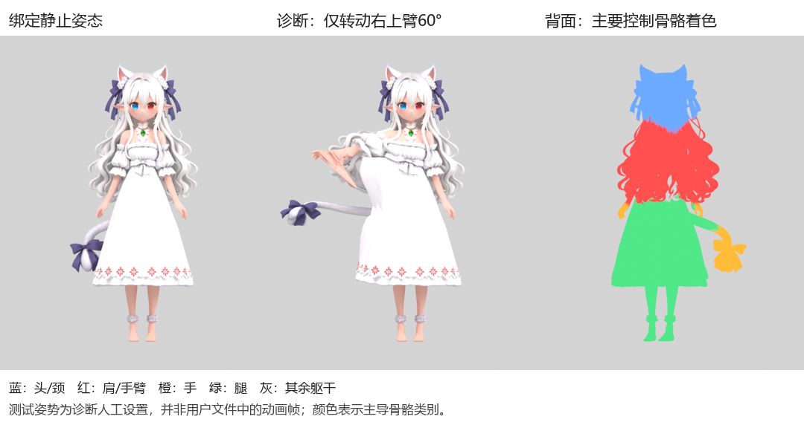

# Meshy 角色绑定异常分析

日期：2026-11-04。输入：用户 Downloads 中的静态与绑定 GLB。已完成文件结构/权重检查和受控姿态渲染；未修改原模型，未调用付费生成服务。

## 结论

头发、裙摆和尾饰的主要问题是自动蒙皮将这些区域分配给了不合适的人体骨骼。只转动右上臂的诊断姿势即可复现头发、裙侧和尾饰拉扯。无需更换图像设计或提高模型精度才能解释这一问题；需先修复部件归属和蒙皮。

另有独立导出问题：用户提供的绑定文件只有一帧姿态数据，没有可播放的连续动画。无法用它复现 Meshy 预览中的原完整动作，因此下方动态变化都明确标为人为设置的诊断姿势。

## 文件检查结果

| 项目 | 静态 Anime_Cat_Girl_Model_191.glb | Rigged Anime Cat Girl HD move.glb |
|---|---:|---:|
| 字节 | 68,794,580 | 43,140,268 |
| 顶点（含属性分裂） | 1,029,836 | 282,040 |
| 三角形 | 1,910,084 | 289,825 |
| 网格/primitive/材质 | 1/1/1 | 1/1/1 |
| skin关节 | 无 | 24 |
| morph targets | 0 | 0 |
| 动画 | 无 | 1个命名clip，实际有效时长0 |

绑定版三角形较静态版减少84.83%，说明导出/绑定流程中几何已被明显处理；仅据两个端点文件不能确定中间具体使用了哪项设置。几何坐标也从居中约1.90单位高调整成地面起算1.66单位高，不能简单逐顶点对比。减面可能影响细节，但这次的直接拉扯证据来自错误骨骼权重。

两个文件只有一个网格及一个材质，没有按头发、服装、身体和尾巴拆成独立对象；这不等于已经证明所有表面拓扑相连，也不等于绝对不能拆分。

绑定版包含身体/头颈/肩臂/腿脚关节，没有独立手指、裙摆、尾巴、发束链。两个文件均无面部形变数据；此文件本身未具备后续所需的独立比耶手指、可驱动眨眼口型和附属物运动体系。

原文件SHA256：

- 静态：`a9bf8774099e61f77cf5c8cda5427dfa4e1106a9718d433606bc3f8eb0ca0ac5`。
- 绑定：`55a81668a5eaced8b16f3c0d4188f6bf6f78ebc3014e90e4688bf4c5afe71ab0`。

## 错误权重证据

左：绑定静止姿态。中：仅人为转动RightArm局部X轴60°，头发、裙侧和尾饰被牵动；不是原clip帧。右：原绑定网格的主导骨骼类别；蓝=头/颈，红=肩/手臂，橙=手，绿=腿，灰=其他躯干。颜色代表谁控制该顶点，不是权重大小热力图。

采样为绑定网格原始 glTF 坐标的明确空间盒，不是完整语义分割。统计是区域内顶点的平均骨骼权重，可含附近其他材料，不能称为整个头发/裙子的比例。

| 采样区 | 顶点数 | 平均权重的重要分配 |
|---|---:|---|
| 背部较高发束候选区 | 44,342 | 双上臂+双前臂约92.02%；Head仅约5.29% |
| 背部低垂发束候选区 | 32,142 | 双上臂+双前臂约94.05% |
| 下裙正面候选区 | 14,147 | 双大腿约96.40% |
| 下裙背面候选区 | 16,194 | 大腿与手混合；RightHand约33.51%，区域可能包含尾饰 |
| 左侧尾饰候选区 | 7,144 | RightHand约61.45%，RightUpLeg约37.68% |

精确范围、分配及骨骼位置见 [glb-analysis.json](../assets/characters/first-character/diagnostics/meshy-2026-11-04/glb-analysis.json)。背视着色图直接显示中下段发束为手臂色、尾饰蝴蝶结为手部色，补足了空间盒统计的语义局限。

权重总和最大误差约`1.79e-7`，无零权重顶点，无越界关节索引。因此不支持“权重没归一/索引损坏”作为主要原因；它们在数值上基本正常，但分配对象不合理。

推断：长发、尾饰与垂手相邻，加上长裙遮挡腿部，普通人体自动绑定未能正确理解这些附属物的归属。没有访问Meshy内部算法，不把“按距离分配”当成已证明的实现原理。

## 连续动画为什么不能复现

命名动画为 `Armature|clip0|baselayer`，包含72条轨道（24节点各自的位移、旋转、缩放）。每条只有1个关键帧，时间均约0.033333秒，所有输出分量的变化范围为0，有效时长为0。

独立GLB解析与Blender导入均得到单帧结果。因此本次交付文件的动画内容不完整；不能据文件名中的“move”或某个未使用的时间数组推断存在一段动作。无法仅凭该文件确定是下载选项、上游导出还是后处理造成，需重新导出实际选中的动作，并核对至少两个不同时间的关键帧及非零持续时间。

## 修复顺序

1. **保留外观与原件，先纠正关节位置和部件归属。** 在能看清身体结构的状态下核对肩、肘、髋、膝、踝。裙子遮挡真实膝位，不能只把标记贴到裙面；当前膝关节深度较前，值得复核，但尚未据隐藏身体确认其正确位置。
2. **修头发。** 清掉不应存在的手臂/手权重。头部近根发束应跟随头部，长发需分段发骨和适当约束/碰撞。临时全部跟Head只能用于检查手臂是否停止拉扯，不能当长发最终物理方案。
3. **修尾饰。** 根部归属臀部上缘/骨盆挂点，尾身设置独立尾链，蝴蝶结按安装位置随动；不跟手腕或大腿摆动。
4. **修长裙。** 裙腰跟随骨盆，裙摆使用专门的裙骨、变形控制或布料方案并处理腿部碰撞。仅将长裙左右分给双腿容易像裤子一样分裂；全部固定在骨盆也不足以支持坐下、舞蹈和抱腿。
5. **核验原动作，再补项目能力。** 重导完整clip，逐项测抬臂、转头、迈腿、坐下与转圈；之后增加手指、表情、换装接口。不要用复杂舞蹈一次性代替局部检查。

当前29万三角形仍需评估桌面常驻开销；生产减面应在正式绑定前完成，避免减面后破坏已制作的权重。调整面数/四边形选项不能单独修好本次错误骨骼归属。

Meshy官方也说明自动绑定需要清晰A/T姿态，并且面部骨骼、尾巴物理等自定义结构需在DCC工具中制作，见 [官方绑定说明](https://docs.meshy.ai/en/webapp/guides/3d-model/rigging)。对本角色，优先进入分件/重新蒙皮验证，不建议仅为解决这些拉扯反复重新生成外观。

## 对产品管线的影响

图片生成网格与可用互动角色之间，需要增加部件识别、附属骨骼/权重规范化及动作验收阶段。统一身体骨架只解决部分动作复用问题，不自动完成头发、裙摆、尾饰、表情和换装。首位固定角色可人工整理；未来用户自助生成，需要把这些步骤的自动化合格率单独验证，不能用一次自动绑定成功作为产品能力证明。

## 复现与边界

- [结构检查脚本](../scripts/analyze-meshy-glb.py)：使用Python/NumPy读取原GLB，输出tmp/meshy-diagnostics/glb-analysis.json，原件只读。
- [诊断渲染脚本](../scripts/render-meshy-diagnostics.py)：使用项目现有隔离bpy运行时；原导入静止图、受控骨骼旋转和主导骨骼着色均单独保存。不输出或覆盖修复模型。
- [静态原模型预览](../assets/characters/first-character/diagnostics/meshy-2026-11-04/static-front.png)、[抬臂试验](../assets/characters/first-character/diagnostics/meshy-2026-11-04/probe-right-upper-arm.png)、[抬腿试验](../assets/characters/first-character/diagnostics/meshy-2026-11-04/probe-left-thigh.png)、[背部骨骼归属](../assets/characters/first-character/diagnostics/meshy-2026-11-04/weights-back.png)。
- 两个源GLB保留在用户Downloads，不纳入Git；项目仅保存诊断脚本、报告和证据图。
- 原clip不含连续运动，尚未验证原完整动画的接地、根运动、循环和所有关节。没有完成拓扑内部连通性、碰撞与自交的全面检查；本报告不将候选空间盒视为精确材质分割。
