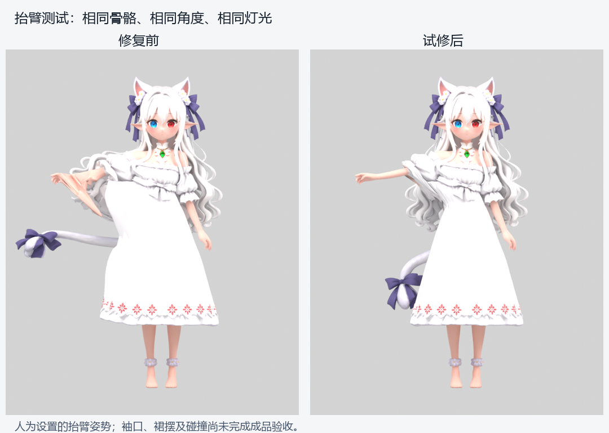

# Meshy 角色本地试修记录

日期：2026-11-04。状态：第一轮修复交付，内部迭代 v04。用于验证错误权重可以纠正，尚未达到完整互动角色的验收标准。

## 本轮处理

- 原始静态 GLB、绑定 GLB 均保持只读，以原绑定版为试修基础。
- 修正主要后发、侧发的错误手臂控制，增加 HairRoot、HairTip 两段控制骨骼。
- 为尾饰增加 TailRoot、TailMid、TailTip，清理尾饰跟随手臂/手掌的问题。
- 调整前臂、手腕附近的权重过渡，减轻抬手时的皮肤拉尖。
- 清理裙身误分给上肢的权重，包含容易被肤色识别误判的粉色裙边花纹。裙摆原有大腿控制仍保留。
- 缩短工作文件中导入后异常长的骨骼显示尾端，保留关节头部、轴向和父子关系，方便后续在 Blender 中查看。
- 生成新的 3 秒检查动作：抬右臂 → 复位 → 转头 → 复位 → 尾饰/发梢小幅控制 → 复位。它不是用户原 Meshy 动作的恢复结果。

没有修改外观造型或重新生成材质。蒙皮权重限制为每顶点最多四个影响并归一化。空间/肤色辅助选择仅针对这个已校验 SHA256 的固定角色，不能直接套用到其他角色。

## 对照与验收证据



采用相同模型基础、镜头、灯光和人为设置的右上臂局部 X 轴 60°。不能用这个姿势证明所有动作都自然。

- [试修后背面](../assets/characters/first-character/diagnostics/meshy-repair-v04/after-raise-arm-back.png)
- [转头检查](../assets/characters/first-character/diagnostics/meshy-repair-v04/after-head-turn-back.png)
- [抬腿检查：仍可见裙摆受大腿牵动](../assets/characters/first-character/diagnostics/meshy-repair-v04/after-step-front.png)
- [补充弯肘检查](../assets/characters/first-character/diagnostics/meshy-repair-v04/supplementary-left-elbow.png)
- [导出后重新导入的附件控制检查](../assets/characters/first-character/diagnostics/meshy-repair-v04/roundtrip-accessory-control.png)

验证记录：

- [处理参数、受控姿势位移和产物 SHA256](../assets/characters/first-character/diagnostics/meshy-repair-v04/repair-result.json)
- [独立 GLB 结构、几何、UV、贴图像素检查](../assets/characters/first-character/diagnostics/meshy-repair-v04/verification.json)
- [重新导入后的连续动作与弯肘裙边检查](../assets/characters/first-character/diagnostics/meshy-repair-v04/roundtrip-verification.json)
- [Blender 工程重读与贴图内嵌检查](../assets/characters/first-character/diagnostics/meshy-repair-v04/blend-verification.json)

最终检查通过：29 个骨骼，289,825 个三角形；连续检查动画时长 3 秒，重新导入后各检查时刻确有变形且结尾回到起点；补充弯肘时下裙摆未再被牵动。静止形状仅有浮点计算误差，基础色和金属/粗糙度贴图解码像素一致。Blender 工程可重新打开，两个贴图均内嵌，无需另找外部纹理文件。

几何检查允许导出器在切线接缝增加少量重复顶点，要求三角形数量相同、导出顶点及 UV 在原模型中具有误差容限内的对应项。它不是逐字节相同或完整拓扑证明；脚本另检查修权重前后静止顶点位置差异。基础色与金属/粗糙度贴图要求解码后像素完全相同。

## 本地产物

目录：`D:/desktop-pet/exports/meshy-repair-v04/`。

| 文件 | 用途 |
|---|---|
| character-weight-repair-v04.glb | 无动画的修订绑定模型，方便继续加工或接入引擎 |
| character-weight-repair-v04-motion-check.glb | 带新制作的 3 秒连续检查动画，优先用于查看修复效果 |
| character-weight-repair-v04.blend | 可继续编辑的 Blender 工程，含骨骼、材质及检查动作 |

大体积模型和 Blender 工作文件放在已被 Git 忽略的 exports 目录；脚本、报告、校验信息和对比图纳入 GitHub。二进制模型版本通过文件名及 SHA256 留档，没有上传到 GitHub。

## 尚未完成

1. **袖口与发束交界细修。** 抬臂时仍有衣袖/腋下区域的拉伸，部分相邻表面需要更精确的人工分区和权重调整。
2. **长裙独立控制。** 本轮没有制作裙骨、布料、腿部碰撞或坐姿修形；仍不能据此承诺坐下、抱腿、芭蕾和跳舞效果。
3. **头发、尾饰的自然运动。** 新增控制骨骼可独立驱动，但没有自动物理、惯性或身体碰撞，大幅转头可能穿模。
4. **表情和手指。** 没有新增眨眼、口型、脸部形变或独立手指骨骼。
5. **性能及完整动作验收。** 未减面，未在目标桌面应用做性能实测；骨骼位置和所有关节/动作也未全面验收。

建议下一轮先完成袖口交界和长裙控制，再测试迈步、坐下，最后制作复杂互动。保持当前外观基线，避免同时改造型和修动作而难以比较。

## 环境与复现

无需另装 Blender 插件。使用项目隔离的 Python 3.11 / bpy 4.2 环境，未连接 Meshy 付费生成服务，也不消耗 Meshy 积分。

```powershell
# 当前 v04 产物目录已存在，修复脚本会拒绝覆盖；再次迭代应先修改脚本中的版本目录及产物文件名。
& .\tmp\modeling-runtime\python311\python.exe .\scripts\repair-meshy-rig.py --inspect
& .\tmp\modeling-runtime\python311\python.exe .\scripts\repair-meshy-rig.py
& .\tmp\modeling-runtime\python311\python.exe .\scripts\check-meshy-repair-roundtrip.py
```

[独立验证脚本](../scripts/verify-meshy-repair.py) 使用含 NumPy、Pillow 的主 Python 运行时。隔离 bpy 在进程退出时会输出已知的内存清理警告；交付是否成功以保存后的文件重读、结构断言和重新导入测试为准。
